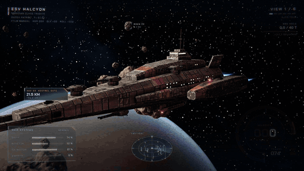

# Space Frigate

Made with the [Estella engine](https://github.com/esengine/estella).

**[Play it in your browser](https://esengine.github.io/estella-space-frigate/)**, or download the whole game as [one 3.4 MB HTML file](https://github.com/esengine/estella-space-frigate/releases/latest). It needs a desktop browser with WebGL2; the first launch bakes the models on your graphics card, which takes about half a minute.



A frigate on patrol: fly her, mine asteroids, fight off raiders with five turrets, and jump through gates from one star system to the next: a banded gas giant, a ringed ice giant and a rust-red desert world. Rocks are solid: running into one costs shield, then hull, and knocks both of you off course. Once you take the helm, raiders arrive in waves and make firing passes; lock one with `T`, face it with `L`, and shoot it down. She sails with a first contract: mine 10 tonnes of ore and deliver it to the gate. The panel at the top of the glass keeps the tonnage aboard and delivered and names the next key to press, the key's button blinks, and the gate's marker lights up once the ore is aboard. Every model, texture, sound and the whole HUD is generated from recipes. There are no hand-painted textures and no models from an outside tool.

## Controls

| Key | Action |
| --- | --- |
| `W` / `S` | Engine order up / down |
| `A` / `D` | Rudder, one step at a time |
| `Q` / `E` | Pitch down / up, one step at a time |
| `X` | Rudder and pitch to neutral (she holds her attitude) |
| `Z` | Come level |
| Click | Lock what you click on; on a desktop, a click on open space takes the mouse to look around (`Esc` gives the cursor back) |
| `T` / `R` | Lock next target (raiders first) / release |
| `F` | Mining beam (cruise mode) |
| `V` / `B` | Autopilot: close on target / align to gate (flying through a gate jumps to the next system) |
| `C` | Fire at will on / off (on from the start): raiders are locked as they come in range, and the turrets train on the locked raider and fire by themselves |
| `G` | Combat mode on / off: the gun camera, to aim and fire by hand |
| `Space` | Fire in combat mode (twice for a salvo, hold to keep firing); toggle the camera tour in cruise mode |
| `L` | Swing the view to the locked target |
| Drag | Look around (a phone, or a desktop without the mouse taken); aim in combat mode |
| Wheel, `1`–`6` | Zoom, camera presets |
| `M` | Music |

Every action also has a button on screen, so it plays on a phone.

## Run it

This repository is the game only. It mounts at `examples/space-frigate` inside an Estella checkout; see the engine's README for building the engine. Then, from the engine root:

```bash
node pipeline/bin/estella.mjs export examples/space-frigate --out output/space-frigate/web --no-aot
```

Tests, from this folder:

```bash
node ../../sdk/node_modules/vitest/vitest.mjs run
```

## Two pilots, one sector

A sector server keeps one rock of ten tonnes and what each pilot has mined from it, and writes both to disk. It is the engine's session host (`esengine/session`) behind a WebSocket, speaking the messages in `proto/sector.proto` as protobuf; `src/shared/sector.ts` and `server/world.ts` hold the rules. A client sends where she is and whether she wants to mine, never an amount: the server pays by its own clock, to a pilot it has signed in, within reach of the rock, until the rock is empty.

```bash
node examples/space-frigate/server/run.mjs --port 8090 --data examples/space-frigate/server-data/sector.json
```

Then open the web export twice, once as each test account:

```
http://127.0.0.1:<port>/?server=ws://127.0.0.1:8090/sector&account=pilot-a&token=test-token-a
http://127.0.0.1:<port>/?server=ws://127.0.0.1:8090/sector&account=pilot-b&token=test-token-b
```

`T` locks the shared rock and `F` mines it. `Ctrl+C` (or `stop` on its input) stops the server and saves; it also saves every second while anything changes. `&wire=json` asks for text frames, to read a session in a debugger. `GET /healthz` gives the books. After a change to `proto/sector.proto`, `node pipeline/bin/estella.mjs proto gen examples/space-frigate` writes `src/proto` again.

`node examples/space-frigate/tools/check-sector.mjs` drives the server as its own process over real sockets (sign-in, a second sign-in taking the seat, replayed and invented requests, a stop and start, a kill, mining to the last gram); `tools/check-online.mjs` does it with two copies of the game in a browser.

Not yet: movement is the client's word held to a frigate's speed, not a helm the server flies; the other 39 rocks of the field are put away in a sector; a sector has no gate out and no raiders; the two accounts and their tokens are fixed test values.

Assets are regenerated from their recipes with `python3 tools/generate.py`.

## License

[Apache-2.0](LICENSE). The piano samples are CC0 and the Chakra Petch font is under the SIL Open Font License; each carries its own licence file.
